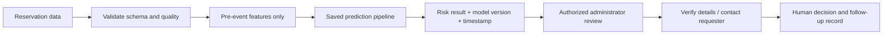

# Decision-Support Workflow

1. **Reservation request / dataset** — staff upload or inspect reservation records.
2. **Schema validation** — required columns, missing values, duplicates, and data quality are checked.
3. **Pre-event preprocessing** — use only User_Type, Facility_Type, Duration_Hours, Participants, Days_Before_Event, After_Office_Hours, and Purpose.
4. **Prediction pipeline** — the saved provisional model returns a risk label and probability if available.
5. **Review queue** — the result is shown with model version and prediction timestamp.
6. **Authorized human review** — administrator checks the source record and contacts the requester when appropriate.
7. **Human decision / follow-up** — staff records their own decision and reason. The model never automatically denies a reservation.

**Important limitation:** `DEMO-RF-0.1` is a provisional baseline. The original facility-reservation midterm notebook and saved pipeline were not supplied.
